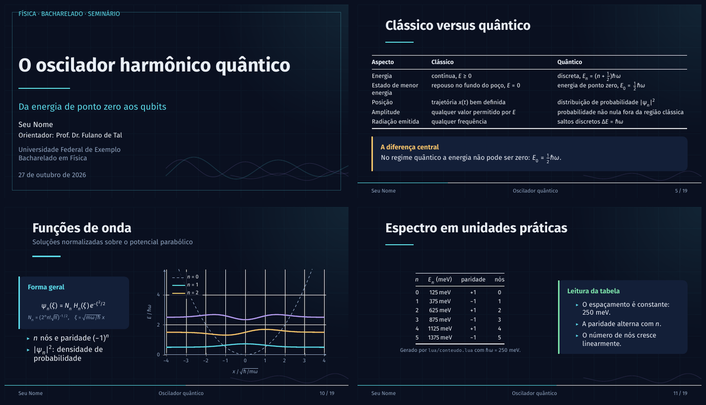

# Template de Apresentação — Física (Beamer + LuaLaTeX)



Template de slides 16:9 para o **Bacharelado em Física**, com visual escuro
("lousa quântica"), tipografia Fira e integração real entre **LaTeX** e **Lua**.
Os slides são escritos em Beamer; os módulos Lua cuidam de constantes físicas,
tabelas, listas de exercícios e da leitura de dados CSV para gerar gráficos
`pgfplots`.

O conteúdo de exemplo é uma apresentação curta sobre o **oscilador harmônico
quântico** — troque o texto e mantenha a estrutura.

---

## Requisitos

- **TeX Live 2025+** (testado com TeX Live 2026) com:
  `lualatex`, `latexmk`, `beamer`, `pgfplots`, `tcolorbox`, `siunitx`,
  `fontspec`, `unicode-math`, `listings`.
- Fontes **Fira Sans**, **Fira Math** e **Fira Mono** (já vêm no TeX Live).
- **Lua 5.3+** apenas para regenerar os dados; a compilação usa o Lua embutido
  no LuaTeX.

No Arch Linux, por exemplo:

```bash
sudo pacman -S texlive-basic texlive-latexextra texlive-fontsextra lua
```

---

## Compilar

Sempre compile **a partir da raiz do projeto** (o Lua procura `./lua` e
`./dados`):

```bash
make
# ou
latexmk -lualatex main.tex
```

O PDF sai em `main.pdf`. Para limpar os arquivos auxiliares:

```bash
make clean
```

> Use **LuaLaTeX**, não pdfLaTeX: o template depende de `fontspec`,
> `unicode-math` e dos módulos Lua.

---

## Estrutura

```text
.
├── main.tex                  # metadados, seções e \input dos slides
├── beamerthemefisica.sty     # tema: cores, fontes, blocos, capa, rodapé
├── fisica.sty                # macros de física + interface LaTeX → Lua
├── content/                  # um arquivo .tex por assunto
│   ├── 01-motivacao.tex
│   ├── 02-classico-quantico.tex
│   ├── 03-schrodinger.tex
│   ├── 04-niveis.tex
│   ├── 05-funcoes-onda.tex
│   ├── 06-tabela-niveis.tex
│   ├── 07-aplicacoes.tex
│   ├── 08-constantes.tex
│   ├── 09-lua.tex
│   ├── 10-exercicios.tex
│   ├── 11-resumo.tex
│   ├── 12-referencias.tex
│   └── 13-obrigado.tex
├── lua/
│   ├── instalar.lua          # registra o buscador de módulos em ./lua
│   ├── constantes.lua        # constantes CODATA 2022
│   ├── conteudo.lua          # roteiro, comparação, níveis, exercícios
│   └── fisica.lua            # funções que escrevem LaTeX via tex.sprint
├── dados/
│   └── oscilador.csv         # x, V(x), psi0, psi1, psi2
├── scripts/
│   └── gerar_dados.lua       # recalcula o CSV
├── preview.png               # imagem de prévia
├── .latexmkrc                # força LuaLaTeX no latexmk
└── Makefile
```

---

## Personalizar

### Metadados e seções

Edite o preâmbulo de `main.tex`:

```latex
\title[Oscilador quântico]{O oscilador harmônico quântico}
\subtitle{Da energia de ponto zero aos qubits}
\author[Seu Nome]{Seu Nome\\[2pt]
  {\small Orientador: Prof.\ Dr.\ Fulano de Tal}}
\institute[UFXX]{Universidade Federal de Exemplo\\
  Bacharelado em Física}
\date{\today}
\fisicaeyebrow{FÍSICA \textperiodcentered{} BACHARELADO}
```

Cada `\section{...}` cria automaticamente uma página de seção. Os slides ficam
em `content/` e são incluídos com `\input`:

```latex
\section{Motivação}
\input{content/01-motivacao}
\input{content/02-classico-quantico}
```

### Cores e tipografia

Tudo o que é visual está em `beamerthemefisica.sty`. A paleta fica no topo:

```latex
\definecolor{fisicabg}{HTML}{0A1020}       % fundo
\definecolor{fisicacard}{HTML}{131F38}     % cartões
\definecolor{fisicacyan}{HTML}{5BD8E8}     % acento principal
\definecolor{fisicaviolet}{HTML}{B49CFF}   % acento secundário
\definecolor{fisicaamber}{HTML}{FFC46B}    % alerta
\definecolor{fisicagreen}{HTML}{7BE0A8}    % exemplo
```

As fontes são carregadas com `fontspec`/`unicode-math`:

```latex
\setsansfont{FiraSans}[...]
\setmonofont{FiraMono}[...]
\setmathfont{FiraMath-Regular.otf}
```

### Caixas disponíveis

```latex
\begin{destaque}{Título}
  Texto normal.
\end{destaque}

\begin{destaque}[fisicaamber]{Atenção}
  Versão âmbar.
\end{destaque}

\begin{equacao}
  \[ E = mc^2 \]
\end{equacao}
```

Também funcionam os blocos padrão do Beamer: `block`, `alertblock` e
`exampleblock`.

---

## Interface LaTeX → Lua

Os comandos abaixo são definidos em `fisica.sty` e leem os módulos de `lua/`:

| Comando | O que faz |
| --- | --- |
| `\cte{hbar}` | `$\hbar = 1.054\,571\,817\times10^{-34}$ J s` |
| `\ctevalor{me}` | valor + unidade, sem o símbolo |
| `\cteunidade{c}` | apenas a unidade (`m/s`) |
| `\ctesimbolo{mp}` | apenas o símbolo (`$m_p$`) |
| `\tabelaconstantes{c,hbar,e,me,mp,kB}` | linhas prontas para um `tabular` |
| `\energia{0}{250}` | energia do nível `n` para `ħω = 250 meV` |
| `\roteiro` | itens do roteiro |
| `\comparacao` | linhas da tabela clássico × quântico |
| `\niveisTabela` | linhas da tabela de níveis |
| `\exercicios` | itens da lista de exercícios |
| `\plotOscilador` | `\addplot`s do potencial e de `ψ₀, ψ₁, ψ₂` |

Exemplo de uso em um slide:

```latex
\begin{frame}{Constantes}
  \begin{tabular}{@{}lll@{}}
    \toprule
    Símbolo & Valor & Grandeza \\
    \midrule
    \tabelaconstantes{c,hbar,e,me}
    \bottomrule
  \end{tabular}
\end{frame}
```

### Adicionar uma constante

Em `lua/constantes.lua`, acrescente uma entrada:

```lua
meuValor = {
  simbolo = "X",
  valor   = "1.234(5)e-6",
  unidade = [[\metre\per\second]],
  nome    = "minha grandeza",
},
```

O campo `valor` usa a sintaxe do `siunitx`; `1.234(5)e-6` significa
`(1.234 ± 0.005) × 10⁻⁶`. Depois basta usar `\cte{meuValor}`.

### Editar roteiro, tabelas e exercícios

Tudo fica em `lua/conteudo.lua`. Por exemplo:

```lua
M.roteiro = {
  { titulo = "Motivação", descricao = "Por que o modelo importa." },
  -- ...
}

M.exercicios = {
  {
    texto = [[Mostre que $[\hat x,\hat p]=i\hbar$.]],
    nivel = "nível 1",
  },
}
```

Os níveis de energia são gerados em um laço:

```lua
for n = 0, 5 do
  M.niveis[#M.niveis + 1] = {
    n        = n,
    energia  = (n + 0.5) * M.hbarOmegaMeV,
    paridade = (n % 2 == 0) and "+1" or "-1",
    nos      = n,
  }
end
```

### Dicas ao escrever Lua que gera LaTeX

- Prefira strings longas `[[...]]` para preservar as barras invertidas:
  `[[\hbar]]`, `[[\qty{1.0}{\metre}]]`.
- **Não** inclua `\n` nas strings enviadas a `tex.sprint`: o LuaTeX trata o
  caractere de nova linha como um glifo. Use espaços para separar comandos.
- Escape `%` como `\%` (o `%` inicia comentário no LaTeX).
- Números decimais devem sair com ponto, não vírgula; as funções do template
  já normalizam isso com `fmt()`.

---

## Dados CSV → gráfico

O gráfico de `content/05-funcoes-onda.tex` é montado em tempo de compilação:

1. `lua/fisica.lua` lê `dados/oscilador.csv`.
2. Cada coluna vira um `\addplot[...] coordinates {...};`.
3. O `pgfplots` desenha dentro do eixo definido no slide.

O CSV tem o formato:

```csv
x,V,psi0,psi1,psi2
-4.0000,8.0000,0.5001,1.4996,2.5017
...
```

Para recalcular os dados:

```bash
make dados
# ou
lua scripts/gerar_dados.lua
```

Para plotar outra coluna, edite `plotOscilador()` em `lua/fisica.lua`. As
funções `fisica.lerCSV(caminho)` e
`fisica.plotarColuna(dados, colX, colY, estilo, legenda)` também ficam
disponíveis para uso em `\directlua`:

```latex
\directlua{
  local d = fisica.lerCSV("dados/meus_dados.csv")
  fisica.plotarColuna(d, 1, 2,
    "draw=fisicacyan, line width=1.5pt, smooth", "minha curva")
}
```

---

## Solução de problemas

**`module 'fisica' not found`**
Compile da raiz do projeto. O arquivo `lua/instalar.lua` registra um buscador
para `./lua`; se você moveu `main.tex` para outra pasta, ajuste o caminho ou
compile com `latexmk -lualatex` a partir da raiz.

**`dados/oscilador.csv` não encontrado**
Rode `make dados` (ou `lua scripts/gerar_dados.lua`).

**Fontes Fira não encontradas**
Instale o pacote de fontes do TeX Live (`texlive-fontsextra` no Arch). Se
preferir outras fontes, troque as chamadas `\setsansfont`, `\setmonofont` e
`\setmathfont` em `beamerthemefisica.sty`.

**Erro do `babel` em TeX Live antigo**
O template usa a API nova:

```latex
\usepackage{babel}
\babelprovide[import,main]{brazilian}
```

Em versões mais antigas do `babel`, troque por:

```latex
\usepackage[brazilian]{babel}
```

**Overleaf**
Envie a pasta inteira (incluindo `lua/` e `dados/`), escolha
*Menu → Compiler → LuaLaTeX* e mantenha `main.tex` como documento principal.

---

## Licença e uso

Use, modifique e distribua livremente este template em trabalhos acadêmicos.
Se ele ajudar, uma menção é bem-vinda — mas não obrigatória.
